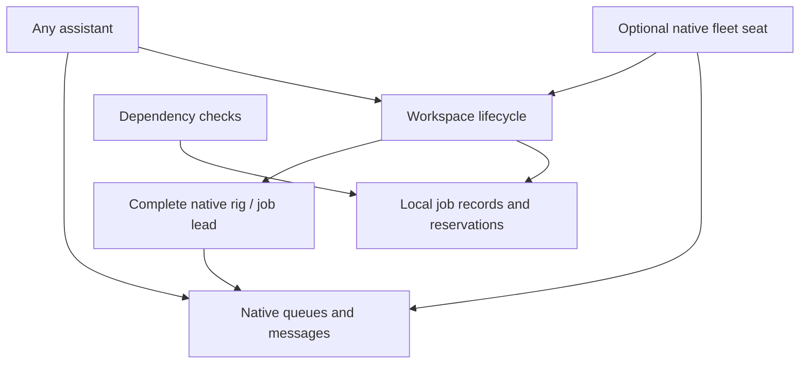

# Blueprint: independent job rigs and optional fleet management

Status: implementation specification reconciled 2026-10-10; replaces the earlier speculative contracts. E1–E7 implemented; 66 isolated tests pass. Automated validation and live-check limits are recorded in [findings](../findings.md).

## Goal

Use any coding assistant to launch a complete reusable OpenRig team in either an existing Git checkout or an optional managed worktree. Each job has its own lead and one exclusively assigned workspace. An optional fleet manager observes jobs and relays requests through native OpenRig identity, queues, and messaging. Closing an assistant session does not lose the job inventory, pending work, or handoffs.

The user authorized completing this design and implementing it without another approval gate. Native OpenRig 0.6.4 mechanisms are reused. Environment isolation and the [future shared-learning integration](../shared-knowledge-integration-idea.md) remain outside this round.

## Acceptance criteria
- AC1 Any assistant can start, inspect, and instruct job rigs without a global lead.
- AC2 An explicit --workspace PATH uses an existing checkout without creating/switching a branch; --worktree creates a branch and linked checkout under project/.worktrees/<job> by default.
- AC3 Only one unfinished job rig reserves a canonical workspace. Simultaneous starts, aliases, and observed legacy rigs cannot bypass checks; refusal names the occupant and offers using it or requesting a separate worktree, without acting on either option.
- AC4 Jobs, resolved templates, preparation checkpoints, native identities, evidence, and dependencies remain queryable across sessions.
- AC5 Stop keeps the reservation; continue/resume reconciles recorded resources. Finish retires the rig and releases the reservation. Existing checkout cleanup is prohibited; managed deletion/detachment is explicit and retains the branch.
- AC6 Native queues hold durable assignments, decisions, updates, and replies, with job tags; status includes queue state and native seat activity. No duplicate attention queue or authentication system is introduced.
- AC7 Fleet management is optional. A stable native manager seat receives coordination; native attachment/handover controls occupation. Releasing the fleet assignment does not stop any session or job. Ordinary assistants can always query and relay.
- AC8 Separate-workspace dependencies wait for human merge and revision availability. Sequential same-workspace jobs require verified retained content after predecessor retirement, without imposing a commit/merge.
- AC9 Complete templates support Codex, Claude, mixed seats, and project overrides for topology/model/runtime/approval; existing instances retain resolved choices.
- AC10 Plans and reads do not mutate state. Launch/cleanup preserves project instructions outside native managed blocks; unsafe resource collisions fail before preparation.
- AC11 Legacy department entry points remain explicit and existing rigs/profiles/services are not automatically migrated, stopped, or recreated.
- AC12 Documentation provides reproducible test commands and explains external CLI polling versus pane delivery, deferred environment isolation, and future external shared-memory integration.

## Shared contracts

### C1 State and ownership

State root: `${OPENRIG_TEAMS_STATE:-${XDG_STATE_HOME:-$HOME/.local/state}/openrig-teams}`. Files: `jobs/<uuid>/manifest.json`, `jobs/<uuid>/rig.yaml`, `jobs/<uuid>/instructions.json`, `fleets/<name>.json`. A state-root directory lock serializes short mutations and lifecycle operations; conflict fails without waiting or automatic lock removal. Atomic private JSON writes retain `version:1`. Job records are the reservation authority: preparing/running/stopped/failed reserve `workspace.path`; finished/removed/detached release it after confirmed retirement. Canonical workspace paths use realpath and Git checkout roots, so symlink/subdirectory aliases compare equally. Existing native inventory is additionally checked through `rig ps --nodes -A --full --json`; unreachable or malformed inventory is unknown and blocks launch. Wrapper UUIDs identify jobs, while native rig/node IDs remain OpenRig-owned opaque strings. No user work is discarded for lock recovery.

### C2 Job and project records

`Job` is `{version:1,id:string,project:string,repo:string,commonDir:string,name:string,branch:string|null,baseCommit:string,workspace:{mode:"existing"|"managed-worktree",path:string,owned:boolean},rigName:string,rigId:string|null,leadAddress:string,seats:Seat[],templatePath:string,templateDigest:string,specPath:string,profilePath:string|null,profileDigest:string|null,preparedRepeatable:boolean,setup:string[],attempt:string|null,lifecycle:"preparing"|"running"|"stopped"|"failed"|"finished"|"removed"|"detached",outcome:"unassigned"|"working"|"waiting-human"|"waiting-dependency"|"verified"|"abandoned",brief:string,briefQueueId:string,evidence:Evidence[],dependencies:Dependency[],handoff:object|null,integrationBranch:string,createdAt:string,updatedAt:string,error:string|null,mergedCommit?:string,mergeAttested?:boolean}`. `Seat` is `{pod:string,member:string,address:string,nodeId:string|null,runtime:"codex"|"claude-code",model:string|null,approval:"native"|"auto"}`. `Evidence` is `{author:string,kind:"review"|"test"|"progress"|"handoff",summary:string,reference:string|null,createdAt:string}`. Verified outcome requires distinct recorded review and test authors belonging to the rig. Native identity comes from `rig whoami --json`; ordinary env-less user-directed sessions may operate wrappers without adopting a seat.

Optional project `.openrig-teams/project.json`: `{version:1,template?:string,integrationBranch?:string,worktreeDirectory?:string,seats?:{"pod.member":{runtime?:string,model?:string,approval?:string}},environment?:{concurrentStacks:string,notes:string}}`. Project overrides apply after template and machine defaults; native restrictions always apply. Shell profiles remain in the existing config directory. New complete-job preview reads literal assignments only, never sources shell profiles. `--repo` can supply a nonliteral path explicitly. Mutating preparation uses existing hooks, but existing mode calls only an explicit `profile_prepare_existing_workspace`. Managed hooks may create/prepare/remove worktrees; custom creation requires a declarative `WORKTREE_PATH` matching the hook output. `PREPARE_REPEATABLE=1` permits an interrupted preparation retry; otherwise continuation refuses ambiguous retries. Profile digest changes block recovery until the original preparation contract is restored.

### C3 Complete rig rendering

Initial `rigs/job/rig.yaml` has `control.lead`, `dev.builder`, `verify.reviewer`, and `verify.tester`; role guidance is sent per seat. All work in the assigned workspace. Custom templates designate `control.lead` and include independent review/test seats. Native member `model` and `path:` agent references are used. Instance spec sits outside the workspace with absolute agent references and a copied relative culture file. Rendered configuration is saved once and reused on resume. Machine settings remain compatible with the existing runtime.json. Claude permission choices are recorded after initial launch and before resume, with the existing next-launch limitation. Codex auto requires the existing optional profile. Native schema validation and selected executable checks run before creation. Tracked instruction files are permitted only through managed-block merging; other tracked projection collisions refuse launch. Instructions are snapshotted before each launch/resume; after teardown original bytes are restored only if nonmanaged content is unchanged, otherwise user edits remain. No generic restore/reset is used.

### C4 Job CLI

New complete-job path: `bin/rig-job start PROJECT NAME (--workspace PATH|--worktree) [--repo PATH] [--template PATH] [--branch REF] [--base REF] [--brief TEXT] [--depends-on ID] [--plan] [--json]`. Only managed mode accepts branch/base options. Legacy `--teams`, old non-UUID finish calls, starts lacking both workspace flags, and existing profile/doctor entry points retain their old implementation. New complete jobs always select an explicit workspace mode. New UUID commands: `list [--project PROJECT]`, `status ID`, `continue ID`, `stop ID`, `resume ID`, `finish ID [--worktree|--detach-worktree]`, `tell ID --message TEXT`, `report ID --outcome VALUE --evidence-file PATH`; read/mutation commands accept `--json`, lifecycle mutations accept `--plan`. Unknown/conflicting flags fail.

Start preflights, reserves, creates managed resources if requested, prepares, snapshots instructions, renders, launches, verifies inventory, applies supported permissions, and queues a stable-ID brief to its lead. It records an attempt before each external effect; ambiguous creation is reconciled from exact recorded path/branch/rig and otherwise blocked. Continue never blindly relaunches an observed rig or repeats a nonrepeatable hook. Status is `{job:Job,live:{state:"running"|"stopped"|"absent"|"unknown",nodes:object[],error:string|null},queue:{items:object[],error:string|null}}`; native activity is retained in nodes. Unknown native state is never absence. Finish verifies rig retirement before cleanup/releasing reservation. All branches remain.

JSON results: `{ok:true,data:object|array}` or `{ok:false,error:{code:string,message:string,jobId:string|null,conflict?:{workspacePath:string,jobId:string|null,rigName:string|null,options:string[]}}}`. Exit 0 success, 1 execution/connectivity, 2 input/config, 3 conflict, 4 dependency blocked. `workspace_occupied` options are `use-existing-rig` and `request-worktree-job`. No automatic stop, takeover, or alternative launch.

### C5 Native coordination

`tell` creates a native qitem with `--destination LEAD --id STABLE_ID --tags job:ID,kind:instruction --body TEXT --summary TEXT --json`. Initial brief uses persisted `briefQueueId` for retry deduplication; continuation first observes an existing correctly tagged/destined qitem, preserving original authorship across caller changes. Managed callers use native CLI identity. The installed queue CLI rejects env-less writes; ordinary human-directed shells therefore use OpenRig's installed DaemonClient and native queue API with declared caller `openrig-teams-shell`, recorded by the native sender resolver as `claimed:v1`, without a seat header or impersonation. Native transport/authentication and ledger provenance stay authoritative. `attention ID --kind decision|permission|failure|progress --summary TEXT --detail TEXT [--destination ADDRESS]` queues a request to the designated fleet manager if present, otherwise the job lead, tagged `job:ID,attention:KIND`; it remains visible through status without a manager. An explicit registered human destination may be supplied with a durable evidence reference. `answer ID QITEM --body TEXT` appends an attributed native queue note and creates an idempotent lead reply qitem; it does not forge human identity, bypass native approval, or mark someone else's task complete. Lead/manager acknowledges through native queue claim/update/handoff. Status queries native `queue list --all --all-rigs --full --json` and filters by job tags; no local copy of queue state. Decision content remains durable even if delivery fails. Native queue persistence is authoritative; wrapper failure reports delivery/persistence uncertainty honestly.

### C6 Optional fleet

`Fleet` is `{version:1,name:string,jobIds:string[],manager:{rigId:string,nodeId:string,address:string}|null,coordinating:boolean,instance?:{id:string,rigName:string,rigId:string|null,workspace:{path:string,mode:"existing",owned:false},seats:Seat[],specPath:string,launched:boolean}}`. `bin/rig-fleet create NAME`, `up NAME`, `add NAME JOB_ID`, `status NAME`, `take NAME --seat ADDRESS`, `release NAME`, and `handover NAME --source SOURCE` accept --json; up/take/release/handover accept --plan. Up optionally creates a native manager instance in a state-directory home, with a frozen spec and recorded native identity; retries reconcile that same instance rather than replace it. A native assignment qitem gives the manager the fleet name and absolute tool paths. Take selects an existing native seat reference and records coordination after verifying its identity. It does not claim that the caller became its occupant. An env-less assistant may select the seat on the human's behalf; a managed caller must actually be that seat. Attachment to unbound seats uses native `rig attach --self`; occupant replacement uses native `rig seat handover`, with its results reported independently. Release only sets coordinating=false, preserving manager identity, queues, session, and jobs. No native detach/stop is implied. External CLI seats can poll queues; installed external_cli bindings lack inbound tmux transport, so automatic pane nudges require a managed pane. Native bindings own identity and handover; no leases, tokens, separate authentication, or heartbeat daemon. Fleet-seat lifecycle authority requires separately saved `FLEET_MAY_SPAWN=1`; ordinary shells are allowed and other job seats cannot spawn sibling jobs.

### C7 Dependencies

`Dependency` is `{jobId:string,policy:"human-merge"|"workspace-handoff",state:"waiting"|"ready"|"blocked",commit:string|null,handoffAcceptedAt?:string}`. Dependencies must be in the same repository, cannot cycle, and cannot refer to abandoned jobs. `merged ID --commit REV` records a human-directed integration revision only after ancestor checks against the recorded source branch/revision and configured integration branch. `--attest` explicitly records a human-authorized squash/rebase mapping. Separate-workspace implementation requires the dependent HEAD to contain that commit; no automatic fetch/merge/rebase/cherry-pick. Investigation may run while waiting, with the restriction in the lead brief. `dependency-check ID` updates readiness. Same-workspace sequential jobs require the predecessor retired and verified plus a matching retained handoff at acceptance, including reuse of a formerly managed checkout as an existing workspace. Once accepted, the recorded baseline permits the dependent job to edit that content; changes before acceptance remain blocked. `handoff ID --file PATH` stores `{head:string,files:[{path:string,kind:"file"|"symlink"|"absent",digest:string|null}]}` using SHA-256 digests and reviewer/tester evidence; paths cannot escape the checkout. No automatic commits or merges. Only one rig reserves that workspace at a time.

## Elements

### E1 state and native tools — new/modify `lib/job-state.mjs, lib/job-tools.mjs, lib/job-native-queue.mjs`

- Serves: AC3, AC4, AC5, AC7.
- Responsibility: Persist private job/fleet records, serialize reservations, and wrap exact native CLI operations.
- Needs: C1, C2, C4; lib/runtime-config.mjs:85 writeAtomic.
- Produces: C1 records and C4 errors/native observations.
- Interface: readJob(id), listJobs(), saveJob(job), withStateLock(fn), run(command,args), nativeInventory(), nativeQueue().
- Rules: Never infer absence from failed reads; reject concurrent locks; validate paths and IDs.
- Verified by: State/CLI fixture tests prove serialization, aliases, error classification, and native response validation.
- Open: none.

### E2 complete rig templates — new/modify `lib/job-rig.mjs, rigs/job/rig.yaml, agents/job/*`

- Serves: AC1, AC2, AC9, AC10.
- Responsibility: Resolve complete native RigSpecs and preserve project instructions.
- Needs: C2, C3; lib/runtime-launch.mjs:18 native schema loading.
- Produces: Frozen C3 spec, seats, culture, instruction snapshots.
- Interface: resolveRig(project,options), renderRig(job,resolution), snapshotInstructions(job), restoreInstructions(job).
- Rules: Both harnesses and project overrides work; unsafe paths fail; preserve user content.
- Verified by: Schema tests and native managed-block fixture round trips for tracked/untracked instructions.
- Open: none.

### E3 workspace lifecycle — new/modify `lib/job-lifecycle.mjs, lib/job-cli.mjs, bin/rig-job`

- Serves: AC1, AC2, AC3, AC4, AC5, AC10, AC11.
- Responsibility: Prepare and reconcile a complete job in the selected workspace mode.
- Needs: E1, E2; C1-C4, C5 stable brief.
- Produces: C4 commands, records and exclusive complete rigs.
- Interface: C4 lifecycle CLI; legacy bash entry moved intact to bin/rig-job-legacy.
- Rules: Existing checkout and user services are preserved; collisions refuse before preparation; ambiguous recovery blocks.
- Verified by: Temporary Git tests for both modes, simultaneous starts, legacy occupancy, recovery, instruction cleanup and dirty/locked deletion.
- Open: none.

### E4 native communication and evidence — new/modify `lib/job-coordination.mjs, lib/job-cli.mjs`

- Serves: AC4, AC6.
- Responsibility: Expose job-tagged native queues and record verification evidence without another attention engine.
- Needs: E1; C2, C4, C5.
- Produces: Native qitems and evidence in job manifests.
- Interface: C4 tell/report and C5 attention/answer.
- Rules: Managed callers must belong to the job or designated fleet; native permissions stay in effect.
- Verified by: Mock native queues verify stable brief IDs, durable tagged requests, attributed responses and distinct verification evidence.
- Open: none.

### E5 fleet assignment — new/modify `lib/job-fleet.mjs, bin/rig-fleet, agents/fleet/manager`

- Serves: AC4, AC7.
- Responsibility: Aggregate jobs and select an optional native coordination seat.
- Needs: E1, E3, E4; C6.
- Produces: Fleet membership and native manager reference.
- Interface: C6 fleet CLI.
- Rules: Release changes assignment only; no session or job stop; handover delegates upstream.
- Verified by: Tests prove take identity, release without lifecycle effects, native handover failure, and offline status.
- Open: none.

### E6 dependency readiness — new/modify `lib/job-dependencies.mjs, lib/job-cli.mjs`

- Serves: AC8.
- Responsibility: Verify merge-first and sequential-workspace prerequisites.
- Needs: E1, E4; C2, C7.
- Produces: Recorded readiness and content handoff.
- Interface: C7 merged/handoff/dependency-check.
- Rules: Never integrate code automatically; stale content and abandoned prerequisites block.
- Verified by: Real Git fixture tests prove merge/stale HEAD/squash attestation and retained same-workspace content.
- Open: none.

### E7 workflow and documentation — new/modify `skills/job-rigs/SKILL.md, README.md, AGENTS.md, docs/job-rigs.md, culture/CULTURE.md`

- Serves: AC1, AC6, AC7, AC11, AC12.
- Responsibility: Teach the implemented tools and keep optional/deferred work separate.
- Needs: E2-E6; C1-C7.
- Produces: Current instructions, examples and test walkthrough.
- Interface: Natural requests map to C4-C7; no automatic global installation.
- Rules: No mandatory global manager or worktree; retain legacy behavior explicitly; shared memory remains deferred.
- Verified by: Walkthrough commands and all automated tests pass; scope/command links reviewed.
- Open: none.

## Wiring

## Build order

1. E1 and E2, then E3: one complete job in each workspace mode; concurrency and recovery checks.
2. E4, then E5 and E6: native attention, optional fleet assignment, dependency readiness.
3. E7 and combined validation: document the actual commands and test both modes end to end.

Each element receives its own specification before implementation. The direct `blueprint-execute` route is used; this environment does not expose an implementer subagent tool.

## Decisions

- One complete rig per reserved workspace; the lead owns that job, while a fleet seat is optional.
- Occupied workspaces produce actionable refusal, not an automatic worktree or takeover.
- Existing checkout use and managed worktree creation are explicit modes with distinct ownership.
- Native queues, identity, attachment, handover, per-member models and managed instruction blocks remain OpenRig responsibilities.
- Fleet release ends coordination, not a session. There are no wrapper leases or extra authentication mechanisms.
- Job records store only workspace/lifecycle/configuration/evidence/dependency metadata; native task state is not copied locally.
- Separate-workspace dependencies require human merge; sequential same-workspace work does not manufacture that requirement.
- Existing services, rigs, profiles and native approval policies remain under their current owners.

## Validation and scope boundaries

- Validate complete instruction launch/cleanup with the native managed-block helpers in temporary fixtures; this is an execution check, not an unresolved architecture question.
- External CLI attachment supplies identity and queue access; installed `external_cli` bindings explicitly lack inbound tmux send/capture (`daemon/dist/domain/session-transport.js:809`). Polling/ordinary relay works without inventing a transport; active nudges use a managed pane.
- Native source references inspected (queue CLI env-less rejection also reproduced without contacting the daemon): `dist/commands/whoami.js`, `dist/commands/attach.js`, `dist/commands/seat.js`, `dist/commands/queue.js`, `dist/client.js`, `daemon/dist/routes/queue.js`, `daemon/dist/routes/require-sender-identity.js`, `daemon/dist/domain/managed-blocks.js`, and `daemon/docs/reference/rig-spec.md` in the installed OpenRig 0.6.4 package.
- External effects can outlive a failed checkpoint. Stable native queue IDs and exact recorded rig/workspace reconciliation prevent blind retries; ambiguous nonrepeatable profile preparation is blocked.
- Workspaces still share machine resources. Port/database isolation and resource scheduling are deferred; project preparation must disclose limitations and never start user services.
- Shared knowledge and continuous learning are tracked in the linked future idea, without a current implementation dependency.
- Automated verification uses real temporary Git repositories and native schema/helpers with a mocked daemon. No real user rig or service is launched for these checks; live harness interaction is the user's final test.
