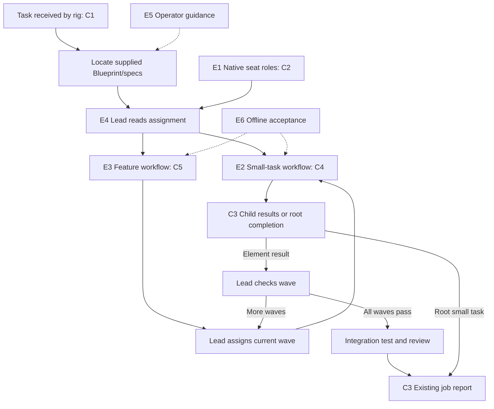

# Blueprint: Spec-driven OpenRig workflows

## Goal

Implement the two custom execution workflows agreed in
[execution-workflows.md](../execution-workflows.md): a small-task cycle and a
Blueprint-feature cycle. Each workflow begins when the rig receives the user's
task or tasks, locates the supplied Blueprint and element specs where applicable,
and executes the assignment through behavioral RED-first testing, implementation,
independent verification, and review.

## Acceptance criteria

- AC1 Small tasks run assignment → RED → implementation → verification → review → report.
- AC2 Blueprint features execute written element specs in build waves, respect dependencies, and finish with integration verification.
- AC3 The tester owns behavioral acceptance tests and meaningful RED; the builder implements without editing those tests, and test corrections receive reviewer scrutiny.
- AC4 Findings return to the responsible seat; unclear requirements, blockers, and repeated repairs without progress escalate through the lead.
- AC5 Completion requires passing verification and review, with results and limitations reported.
- AC6 Both workflows begin with tasks received by the rig, locate supplied documents from the assignment, and execute in the assigned existing checkout or worktree.

## Shared contracts

### C1 Selection and assignment

Selection uses the existing `--brief TEXT` on `rig-job start` or `--message TEXT`
on `rig-job tell`; there is no new launcher flag or handoff subsystem.
The brief is human-readable text with these labels:

- `Workflow: small-task | blueprint-feature` — exactly one value.
- `Workflow guide: <absolute path to docs/execution-workflows.md>`.
- `Task: <requested outcome and expected behavior>`.
- `Spec: <document path>` — optional for small tasks.
- `Blueprint: <document path>` and `Specs: <directory path>` — required for features.
- `Elements: all | <comma-separated E ids>` — required for features.

Document and spec-directory paths may be absolute or relative to the assigned
workspace; relative paths resolve from that workspace. The usual layout is
`docs/blueprints/<name>.md` and `docs/blueprints/<name>/E<n>-<element-name>.md`.
Explicit assignment paths take precedence over this convention. The lead reads
the Blueprint's element IDs and locates each selected element's spec in the
supplied directory. Missing or ambiguous matches require clarification.

Paths identify documents already written and available to the seats. Missing
documents or unresolved Contract issues block affected execution. No automatic
copying, specification generation, approval tracking, or document rewriting is
introduced. Work without a workflow selection keeps the existing job behavior.

### C2 Native workflow binding

- New files: `workflows/small-task.yaml` and `workflows/blueprint-feature.yaml`.
- Native envelope: `workflow.id` is respectively `small-task` or `blueprint-feature`; `workflow.version` is `1`.
- Workflow roles are `lead`, `builder`, `tester`, and `reviewer`, declared without fixed `preferred_targets` or a fixed `target.rig`.
- Rig member roles: `control.lead → lead`, `dev.builder → builder`, `verify.tester → tester`, `verify.reviewer → reviewer`.
- The lead starts an instance with `rig workflow instantiate SPEC --root-objective TEXT --created-by LEAD --rig RIG --json` using its actual identity and job rig.
- `TEXT` contains C1's assignment and the job ID; an element instance also includes `Element: E<n>`, `Parent workflow: <instance ID>`, and its exact spec path.
- A step owner advances with `rig workflow project --instance ID --current-packet QITEM --exit EXIT --actor-session SELF --result-note TEXT --json`.
- `EXIT` is the native enum `handoff | waiting | done | failed`; steps declare their permitted exits and explicit step-ID routing.
- Both files declare `loop_guards.max_hops: 40`; an exhausted instance stops for lead inspection, never automatic repeated resume.
- `waiting` parks the current step without completing it; the owner resumes the same step after the blocker resolves. An unmapped `failed` terminates the run for inspection.

### C3 Evidence and completion

Use existing native queue notes and step result notes, not a new evidence store.
Each stage reports its task/element, actual result, relevant commands and outputs,
and limitations. RED notes identify the failing behavioral assertion and why it
establishes missing behavior. A nonbehavioral task records its alternative check.

Tester-owned acceptance-test paths are named in the RED note. The builder may
read/run them and add its own tests, but must return requested corrections to
the tester. A correction identifies the requirement and receives reviewer
scrutiny before renewed RED or the documented alternative check.

The final lead report uses the existing `rig-job report ID --outcome verified
--evidence-file PATH` interface. Its JSON array retains the existing entry shape:
`{author:string, kind:"review"|"test"|"progress"|"handoff", summary:string,
reference:string|null}`. Reviewer and tester authors are actual distinct job
seat addresses. Their reports must describe the delivered result and passing
checks; missing required checks block completion. Corrections rerun affected
verification and review.

An element instance's report contributes evidence to its parent; it never marks
the entire job verified. Only the root small task or completed feature reports
the job outcome. No new evidence validator or filesystem test protection is
part of this plan.

### C4 Small-task transitions

All steps permit unmapped `waiting` and `failed` unless mapped below.
`report` permits `done` for successful terminal closure.

| Step | Role | Exit → next step |
| --- | --- | --- |
| assignment | lead | handoff → red |
| red | tester | handoff → implement; failed → triage |
| implement | builder | handoff → verify; failed → triage |
| verify | tester | handoff → review; failed → triage |
| review | reviewer | handoff → report; failed → triage |
| triage | lead | handoff → implement; done → correct-tests; failed → terminal failure |
| correct-tests | tester | handoff → review-tests; failed → triage |
| review-tests | reviewer | handoff → red; failed → correct-tests |
| report | lead | done → terminal success |

The `red → implement` transition requires meaningful behavioral RED or the
documented nonbehavioral alternative. `triage → implement` is only for an
implementation finding with that prerequisite already established. Invalid
tests return through `correct-tests → review-tests → red`. Requirement,
environment, or permission blockers park with lead attention. The tester's
verification and reviewer's acceptance are both required before `report`.

### C5 Feature transitions and wave assignments

| Step | Role | Exit → next step |
| --- | --- | --- |
| assignment | lead | handoff → assign-wave |
| assign-wave | lead | handoff → check-wave |
| check-wave | lead | handoff → assign-wave; done → integration-test; failed → triage |
| integration-test | tester | handoff → integration-review; failed → triage |
| integration-review | reviewer | handoff → report; failed → triage |
| triage | lead | handoff → assign-wave; failed → terminal failure |
| report | lead | done → terminal success |

Every step also permits unmapped `waiting` and `failed` unless mapped above.
The lead reads the existing Blueprint build order and starts one C4 instance
per assigned element in the current wave. Its native queue note records the
wave, element IDs/spec paths, child instance IDs, and editing/test-resource
boundaries. Child instances reuse the job's seats; they are not new rig jobs.

`check-wave` stays at its current step while children are incomplete; `waiting`
names the outstanding child/blocker and continuation. All current-wave elements
must pass their spec completion checks and C4 review before advancement.
`handoff` means another selected wave remains; `done` means all selected waves
passed. Prerequisites outside the selected scope must already be satisfied.

The four-seat default executes conflicting elements serially. Parallel elements
require safe editing/test resources and an explicitly selected topology with
capacity. This round adds no topology inference or automatic seat spawning.
The lead keeps each assignment's builder consistent using native explicit owner
selection where a topology has multiple builders.

Integration findings return through `triage` to assignments for affected elements.
The lead identifies affected dependents and reruns their checks before integration
acceptance; previously completed child instances remain historical evidence.
Repeated repairs without progress escalate rather than loop indefinitely.

## Elements

### E1 Workflow role declarations — RigSpec — modify `rigs/job/rig.yaml`

- Serves: AC1, AC2, AC6.
- Responsibility: Make the existing complete-job seats addressable by native workflow roles.
- Needs: C2; existing template `rigs/job/rig.yaml:8`; `resolveRig(project, options)` in `lib/job-rig.mjs:18`.
- Produces: The C2 role declarations on the existing four seats.
- Interface: Native RigSpec member `role: string`; retain existing pod/member IDs and AgentSpec references.
- Rules: Runtime/model/approval overrides and workspace behavior remain governed by existing job resolution.
- Verified by: Native RigSpec validation and job previews preserve four-seat identity/settings in both workspace modes while exposing C2 roles.
- Open: none.

### E2 Small-task cycle — WorkflowSpec — new `workflows/small-task.yaml`

- Serves: AC1, AC3, AC4, AC5.
- Responsibility: Route one bounded assignment through behavioral testing, implementation, verification, review, and bounded repair.
- Needs: C2, C3, C4.
- Produces: Native step packets and stage transitions for one assignment.
- Interface: C2 WorkflowSpec and C4 step IDs, role assignments, allowed exits, and routes.
- Rules: No planning stage; no successful closure before verification/review; test corrections use their own route; intentional waiting never skips a stage.
- Verified by: Isolated native runtime checks traverse success, implementation repair, test correction, waiting, and max-hop failure paths.
- Open: none.

### E3 Feature wave cycle — WorkflowSpec — new `workflows/blueprint-feature.yaml`

- Serves: AC2, AC4, AC5, AC6.
- Responsibility: Coordinate execution of written element specs by wave and require integrated verification/review.
- Needs: C2, C3, C5; element execution through E2/C4.
- Produces: Parent workflow packets for wave coordination, integration, and final reporting.
- Interface: C2 WorkflowSpec and C5 step IDs, role assignments, allowed exits, and routes.
- Rules: No spec generation or replanning; no sibling rig creation; incomplete waves wait; integration failures return to element assignments.
- Verified by: Isolated runtime checks exercise another-wave routing, final-wave integration, integration repair, and waiting without premature completion.
- Open: none.

### E4 Seat execution guidance — role guidance — modify `agents/job/lead/guidance/role.md` and peer role files

- Serves: AC1, AC2, AC3, AC4, AC5, AC6.
- Responsibility: Teach each existing seat to execute its selected workflow stage from written requirements and native evidence.
- Needs: C1–C5; E1–E3; existing lead dispatch at `agents/job/lead/guidance/role.md:5`, builder handoff at `agents/job/builder/guidance/role.md:3`, tester checks at `agents/job/tester/guidance/role.md:3`, reviewer checks at `agents/job/reviewer/guidance/role.md:3`.
- Produces: Conditional workflow instructions for all four seats; tester skill selection in `agents/job/tester/agent.yaml` includes the existing `test-driven-development` resource.
- Interface: C1 selection, C2 native commands, C3 reports, and C4/C5 stage responsibilities; peer files are `agents/job/{builder,tester,reviewer}/guidance/role.md`.
- Rules: Tester writes acceptance tests but does not fix production code; builder preserves tester-owned tests; reviewer examines observable behavior and quality; lead locates supplied specs, coordinates, and escalates.
- Verified by: A role walkthrough covers both workflows, nonbehavioral work, incorrect tests, blocked requirements, child reporting, and unchanged unselected-job behavior.
- Open: none.

### E5 Invocation and operator guidance — documentation/skill — modify `docs/execution-workflows.md` and `skills/job-rigs/SKILL.md`

- Serves: AC1, AC2, AC4, AC5, AC6.
- Responsibility: Make the two workflows invocable through existing complete-job briefs and explain inspection, waiting, and completion.
- Needs: C1–C5; E1–E4; existing job invocation in `lib/job-cli.mjs:9`, brief delivery in `lib/job-coordination.mjs:30`, and job workflow guidance in `skills/job-rigs/SKILL.md:7`.
- Produces: Usage examples for small tasks and feature specs in both workspace modes, plus a reference from `docs/job-rigs.md`.
- Interface: Existing `rig-job start`, `tell`, `status`, `attention`, and `report`; native workflow `show`, `trace`, `project`, and `resume`.
- Rules: Guidance begins with tasks received by the rig; supplied document paths resolve per C1; preserve exact spec contracts; previews launch nothing; unavailable documents block affected execution; native workflow visibility complements existing job status.
- Verified by: Examples use existing CLI flags and expose the correct workflow/spec inputs without introducing a new handoff or preparation process.
- Open: none.

### E6 Workflow acceptance checks — tests — new `tests/job-workflows.test.mjs`

- Serves: AC1, AC2, AC3, AC4, AC5, AC6.
- Responsibility: Verify the native routing and job compatibility of the two workflow definitions without launching live seats.
- Needs: C1–C5; E1–E5; installed package discovery `findOpenRigPackage(env)` in `lib/runtime-config.mjs:69`; native-schema testing precedent `tests/job-rigs.test.mjs:139`; isolated fixture `tests/fixture.mjs:11`.
- Produces: Offline tests using temporary state/native schemas and runtime with synthetic seats and evidence; fixtures include new workflow files where needed.
- Interface: `node --test tests/job-workflows.test.mjs` and existing `node --test tests/*.test.mjs`.
- Rules: Test observable routing and blocking behavior rather than prose snapshots; use isolated native fixtures without model calls, live rigs, or services.
- Verified by: Both workflows validate; packets reach the intended seats through success/repair/wait paths; bounded loops terminate; child completion does not complete the root; existing checkout/worktree behavior passes regression checks.
- Open: none.

## Wiring

## Build order

- Wave 1 (parallel): E1 and E2.
- Wave 2: E3 (needs E2).
- Wave 3: E4 (needs E1–E3).
- Wave 4: E5 (needs E4).
- Wave 5: E6 (needs E1–E5); final integrated verification.

Element implementation includes its own relevant checks; E6 supplies the complete
offline workflow acceptance scenarios.

## Decisions

- Extend native workflow routing and existing role guidance — the installed runtime already owns durable packets, role binding, waiting, and bounded loops.
- Use existing briefs to select a workflow — no new launcher API, handoff subsystem, or approval mechanism is necessary.
- Bind abstract roles to the actual job rig — generated job names must not be hard-coded into workflow files.
- Keep four seats as the default — the tester owns RED and verification; additional seats remain explicit topology choices.
- Coordinate waves through the lead and native element instances — written build order stays authoritative without introducing a Blueprint parser/compiler.
- Keep behavioral test ownership as a role rule — technical write isolation and new evidence enforcement are outside the agreed scope.
- Start at receipt of the assigned work — the workflow covers locating supplied documents and executing their tasks through completion.

## Risks and unknowns

- E2/E3: Native routing checks exits and ownership; agents still judge RED, wave readiness, and result quality. Offline runtime checks do not prove live agent adherence.
- E4: The existing tester instruction says to run checks without fixing code; new guidance must explicitly permit acceptance-test authoring while retaining the production-code boundary.
- E3/E4: Multiple elements sharing files or test resources require serial assignment; worktrees alone do not isolate databases or ports.
- E5: Uncommitted specs may be unavailable in a new worktree. The user supplies accessible document paths through the brief; copying or versioning them is not automated here.
- E6: The installed OpenRig package is the compatibility source; native runtime test setup must use its actual exports rather than guessed APIs.
- No blocking design unknowns remain; exact native fixture setup and detailed test cases belong in the element specs.

## Verified integration references

Installed package root in this research:
`/home/fhillip/.nvm/versions/node/v24.21.0/lib/node_modules/@openrig/cli`.
These paths are relative to that root and were read for this Blueprint:

- `daemon/dist/domain/rigspec-schema.js:456`: RigSpec member role validation.
- `daemon/dist/domain/workflow-projector.js:1205`: `resolveDefaultOwner` resolves roles on a bound rig when preferred targets are absent.
- `dist/commands/workflow.js:197`: native workflow instantiation and its supported options.
- `dist/commands/workflow.js:241`: native packet projection command and exit/evidence options.
- `daemon/dist/domain/workflow-validator.js:22`: `WorkflowValidator.validate(spec, seatLivenessCheck, hostRegistryLookup)`.
- `daemon/dist/builtins/workflow-specs/branched-remediation.yaml`: installed example of conditional repair routing under `max_hops`.

Status: Blueprint only. No workflow, role, or runtime implementation has been
changed by this document. Element specs follow review of this Blueprint.

Blueprint checks: all six acceptance criteria map to elements; every element
has the required template fields. Both proposed transition tables passed the
installed native `WorkflowValidator`, and each mapped exit resolved to its
declared next step through `resolveNextStep`. No live instance was started.
